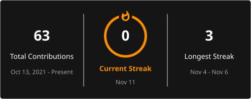

<div align="center">

# ✦ PRECIOUS ✦

### CREATIVE ENGINEER · SOFTWARE DEVELOPMENT · GAME SYSTEMS

**Where creativity meets code, and ideas become interactive experiences.**

<p align="center">
  <a href="https://preciouscrazy.github.io/Preciouscrazy/"><strong>▶ PLAY THE INTERACTIVE SPACE SHOOTER</strong></a><br>
  <sub>Mouse or touch to steer · Click or press Space to fire</sub>
</p>

## 🌐 Socials:
[](mailto:preciouscrazy@gmail.com) 

I'm Precious — a creative technologist bringing together visual design, software engineering, and game development. I build independent prototypes that explore game performance, reliability, competitive fairness, and player experience.

# 💻 Tech Stack

<p align="center">
  
  
  
  
  
  
  
  
  
  
  
  
  
  
  
  
  
  
</p>

# 📊 GitHub Stats:
<br/>
<br/>


</div>

---

## ◈ ABOUT ME

I approach software from three perspectives:

- **Engineer:** Build understandable systems, validate inputs, test assumptions, and explain tradeoffs.
- **Designer:** Make complex information clear, usable, and visually intentional.
- **Game developer:** Explore the mechanics and systems behind responsive, fair, engaging player experiences.

I'm developing my skills through hands-on projects and independent learning, with a particular interest in software engineering for games and player-facing technology.

## ⌘ TECHNICAL TOOLKIT

| Area | Tools and interests |
|:--|:--|
| **Programming** | C++, Python, JavaScript |
| **Systems & analysis** | Performance telemetry, frame timing, simulation, CSV/JSON data pipelines |
| **Software engineering** | Debugging, unit tests, Git, GitHub Actions, CMake, documentation |
| **Web & design** | HTML, CSS, interface concepts, typography, visual hierarchy |
| **Game development** | Gameplay prototyping, player experience, matchmaking concepts |

## 🎮 FEATURED ENGINEERING PROJECTS

Three projects that best represent my current work in performance analysis, data processing, and algorithms.

### 01 — [RiftPulse](https://github.com/preciouscrazy/riot-riftpulse)

**Game telemetry analysis · C++20 · CMake**

A command-line match-event analyzer that validates CSV data, aggregates per-player statistics, identifies dense event windows for review, and exports structured JSON reports.

**Engineering focus:** structured parsing, data modeling, aggregation, deterministic reporting, error handling, and automated testing.

`C++20` `CMAKE` `CSV` `JSON` `TESTING`

### 02 — [FrameTrace](https://github.com/preciouscrazy/FrameTrace)

**Frame-time diagnostics · Python · Performance analysis**

An offline tool for examining frame-time samples, calculating percentile-based metrics, approximating 1% low FPS, and identifying consecutive stutter events.

**Engineering focus:** statistical summaries, reproducible analysis, threshold-based event detection, and communicating measurement limitations.

`PYTHON` `FRAME TIMES` `PERFORMANCE` `UNIT TESTS`

### 03 — [MatchFair](https://github.com/preciouscrazy/MatchFair)

**Matchmaking simulation · Python · Algorithms**

A deterministic, region-scoped team-balancing prototype that explores skill-rating differences and queue-wait tradeoffs using synthetic player data.

**Engineering focus:** combinatorial search, deterministic tie-breaking, input validation, complexity constraints, and fairness tradeoffs.

`PYTHON` `ALGORITHMS` `SIMULATION` `DATA ANALYSIS`

## ✧ MORE GAME-SYSTEMS PROJECTS

These smaller prototypes broaden my experience across reliability, regression analysis, and player-centered systems.

| Project | What it explores | Primary skills |
|:--|:--|:--|
| **[PatchPulse](https://github.com/preciouscrazy/PatchPulse)** | Compares before/after game-update telemetry and highlights potential performance regressions | Python, cohort comparison, reporting |
| **[FriendShield](https://github.com/preciouscrazy/FriendShield)** | Generates an explainable, human-review queue for suspicious friend-request signals | Python, rule-based scoring, privacy-aware design |
| **[RankLens](https://github.com/preciouscrazy/RankLens)** | Models and examines ranked-rating behavior using an educational analytics approach | Python, simulation, analysis |
| **[RiftGuard](https://github.com/preciouscrazy/RiftGuard)** | Explores reliability monitoring and event-based diagnostic signals | Python, monitoring, event analysis |

> **Project scope:** These are independent educational prototypes. They use local or synthetic data and are not official Riot Games integrations, production matchmaking services, anti-cheat tools, or validated bot detectors. Any warnings, scores, or flags are analytical signals—not proof of misconduct or causation.

## ✦ CREATIVE PLAYGROUND

**[Space Shooter Heatmap — interactive browser game](https://preciouscrazy.github.io/Preciouscrazy/)**  
A compact arcade prototype with pointer and touch steering, click or Space firing, an animated activity field, score, and sector progression. [Play the game](https://preciouscrazy.github.io/Preciouscrazy/) · [View the source](https://github.com/Preciouscrazy/Preciouscrazy/tree/main/space-shooter).

**Mini Clash — browser fighting-game prototype**  
An original interactive game concept featuring movement, attacks, blocking, health management, and a CPU opponent. Built with JavaScript, HTML, and CSS. The repository is being prepared for publication.

## ✧ HOW I BUILD

```text
01  OBSERVE    → Identify a player or engineering problem
02  DESIGN     → Define data, constraints, and a useful interface
03  ENGINEER   → Implement a focused, testable prototype
04  VALIDATE   → Run tests, examine edge cases, measure behavior
05  REFINE     → Document limitations and improve the design
```

I care about explaining *why* a solution works, where it might fail, and how I would improve it—not just showing that the code runs.

## 🚀 CURRENT FOCUS

- Deepening my C++ and Python software engineering fundamentals.
- Improving automated testing, performance measurement, and technical documentation.
- Learning how game systems balance responsiveness, reliability, fairness, and usability.
- Building a portfolio of practical, clearly scoped projects for gaming-industry software engineering roles.

---

<div align="center">

### ✦ PRECIOUS · `preciouscrazy` ✦

**Design with intention · Code with purpose · Keep leveling up**

[Explore my repositories](https://github.com/preciouscrazy?tab=repositories)

</div>
