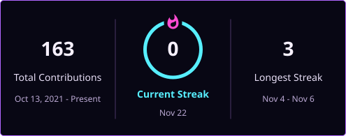

**CREATIVE TECHNOLOGIST · SOFTWARE DEVELOPMENT · GAME SYSTEMS**

I’m Precious — a creative technologist attending **Lamar University (expected graduation: 2028)** with a background in graphic design. I build and test **C++ and Python game-systems prototypes** focused on performance diagnostics, reliability, deterministic behavior, and player experience.

**ENGINEERING FOCUS** · C++20 · Python · data structures & algorithms · debugging · automated tests · Windows/Ubuntu CI

> **Portfolio scope:** Independent projects using local or synthetic data. They are not official game integrations or measurements from production Riot Games systems.

##  FEATURED SYSTEMS // CODE + EVIDENCE

Three projects I can explain end to end, from design choices to validation and limitations.

### 

**Game telemetry analysis** · A C++20 CLI that validates match-event CSVs, aggregates statistics, identifies dense event windows, and produces reproducible JSON reports.

**ENGINEERING PROOF** · Three CTest targets, including C++ and CLI regression checks · Windows and Ubuntu CI passed

**EXPLORE** · [Architecture & decisions](https://github.com/Preciouscrazy/riot-riftpulse/blob/main/docs/case-study.md) · [Validation & evidence](https://github.com/Preciouscrazy/riot-riftpulse/blob/main/evidence/validation-matrix.md) · [Successful CI](https://github.com/Preciouscrazy/riot-riftpulse/actions/runs/43692186021)

### 

**Frame-time diagnostics** · An offline analyzer for median and tail frame times, approximate 1% low FPS, and consecutive stutter events.

**ENGINEERING PROOF** · 34 unit/CLI regression tests · Python 3.10–3.12 on Windows and Ubuntu · Local Python 3.15 validation

**EXPLORE** · [Architecture & decisions](https://github.com/Preciouscrazy/FrameTrace/blob/main/docs/case-study.md) · [Validation & sample results](https://github.com/Preciouscrazy/FrameTrace/blob/main/evidence/validation.md) · [Successful CI](https://github.com/Preciouscrazy/FrameTrace/actions/runs/43693133703)

### 

**Matchmaking simulation** · Deterministic, region-scoped team balancing that shows the difference between optimizing team skill gaps and changing queue selection.

**ENGINEERING PROOF** · 42 unit/CLI regression tests · Python 3.10–3.12 on Windows and Ubuntu · Local Python 3.15 validation

**EXPLORE** · [Architecture & tradeoffs](https://github.com/Preciouscrazy/MatchFair/blob/main/docs/case-study.md) · [Synthetic validation](https://github.com/Preciouscrazy/MatchFair/blob/main/evidence/validation.md) · [Successful CI](https://github.com/Preciouscrazy/MatchFair/actions/runs/43694056035)

##  VERIFIED C++ LAB // MORE SYSTEMS WORK

| System | Engineering question | Evidence |
|:--|:--|:--|
| **[NetSyncLab](https://github.com/Preciouscrazy/NetSyncLab)** · C++20 | How do prediction, packet loss, and bounded retransmission affect simulated convergence? | [Case study](https://github.com/Preciouscrazy/NetSyncLab/blob/main/docs/case-study.md) · [Comparison](https://github.com/Preciouscrazy/NetSyncLab/blob/main/evidence/retransmission-comparison.csv) · [CI](https://github.com/Preciouscrazy/NetSyncLab/actions/runs/43690695394) |
| **[ReplayForge](https://github.com/Preciouscrazy/ReplayForge)** · C++20 | Can deterministic replay identify the first divergent simulation tick? | [Design](https://github.com/Preciouscrazy/ReplayForge/blob/main/docs/design.md) · [Test evidence](https://github.com/Preciouscrazy/ReplayForge/blob/main/evidence/windows-validation.md) · [CI](https://github.com/Preciouscrazy/ReplayForge/actions/runs/43687631896) |

Both are independent synthetic simulations with passing Windows and Ubuntu CI, not live multiplayer or networking benchmarks.

##  CORE STACK // ENGINEERING FIRST

  
  
  
  
  
  
  
  

**DEVELOPMENT WORKBENCH** · C++20 · Python · CMake · Git/GitHub · GitHub Actions · CLI tools · CSV/JSON · unit/regression tests

<strong>✦ Visual design, web & creative tools</strong>

My graphic-design background informs interface clarity, visual hierarchy, and how I communicate engineering results.

  
  
  
  
  
  
  
  
  

##  GAME-SYSTEMS LAB

| **PROJECT** | **EXPERIMENT** | **TOOLS** |
|:--|:--|:--|
| [PatchPulse](https://github.com/preciouscrazy/PatchPulse) | Compares before/after game-update telemetry and highlights potential performance regressions | Python · cohort comparison · reporting |
| [FriendShield](https://github.com/preciouscrazy/FriendShield) | Creates an explainable human-review queue from suspicious friend-request signals | Python · rule-based scoring · privacy-aware design |
| [RankLens](https://github.com/preciouscrazy/RankLens) | Models hypothetical ranked-rating behavior for educational analysis | Python · simulation · analysis |
| [RiftGuard](https://github.com/preciouscrazy/RiftGuard) | Explores reliability monitoring and event-based diagnostic signals | Python · monitoring · event analysis |

> **Scope note:** These are independent educational prototypes using local or synthetic data. They are not official Riot Games integrations, production matchmaking services, anti-cheat tools, or validated bot detectors. Scores and flags are analytical signals, not proof of misconduct or causation.

##  SIGNALS // GITHUB ACTIVITY

<strong>View contribution and language cards</strong>

  
   
  
   
  

##  CURRENT FOCUS

I’m sharpening algorithms, C++ and Python fundamentals, debugging, testing, and technical communication for software engineering roles in games. My goal is to show **how I built a system, what I verified, and where its limitations are**.

---

**PRECIOUS // PLAYER-FIRST ENGINEERING · VISUAL DESIGN · GAME SYSTEMS**

[Explore all repositories](https://github.com/Preciouscrazy?tab=repositories)

